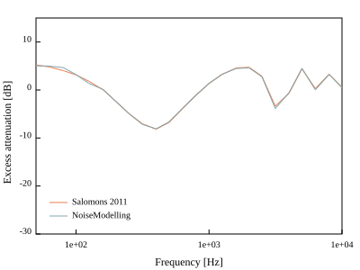
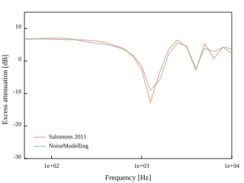
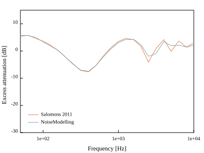
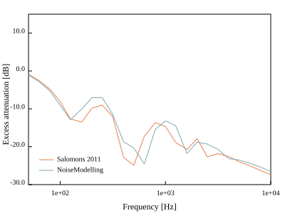
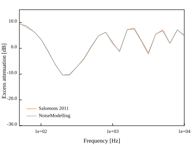
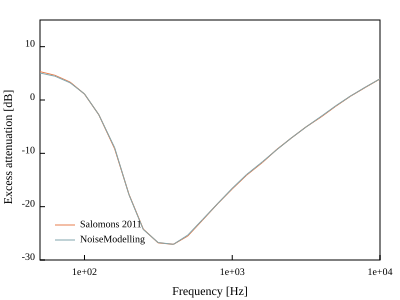
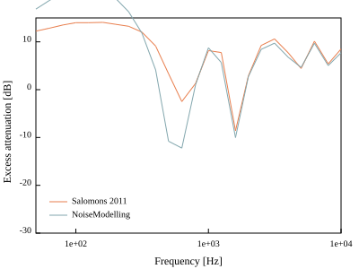
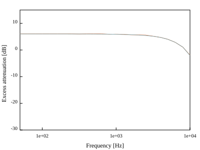
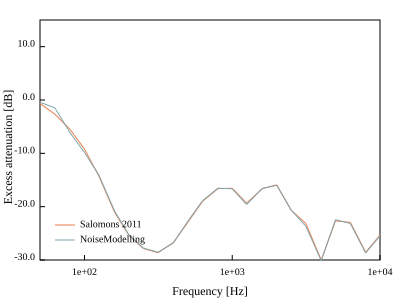
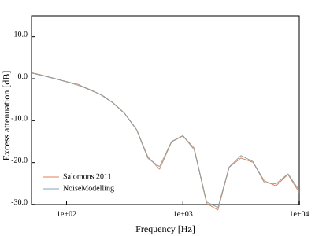

Harmonoise
^^^^^^^^^^^^^^^^^

Validation
--------------------------------

.. figure:: images/Validation/Harmonoise/case01.svg
	:align: center
Case 1: Flat rigid ground, non-refracting, 75m

Case 2: Flat absorbing ground, non-refracting, 75m

Case 3: Flat rigid ground, lin. profile, 75m

Case 4: Flat absorbing ground, lin profile, 75m

Case 5: Sound barrier, absorbing ground, non-refracting, 75m

Case 9: Flat absorbing ground, lin/log profile, 300m

Case 10: Flat absorbing ground, non-refracting, 300m

Case 11: Flat rigid ground, lin/log profile, 300m

Case 12: Flat rigid ground, non-refracting, 300m

Case 14: Sound barrier, absorbing ground, non-refracting, 300m

Case 16: Sound barrier, rigid ground, non-refracting, 300m